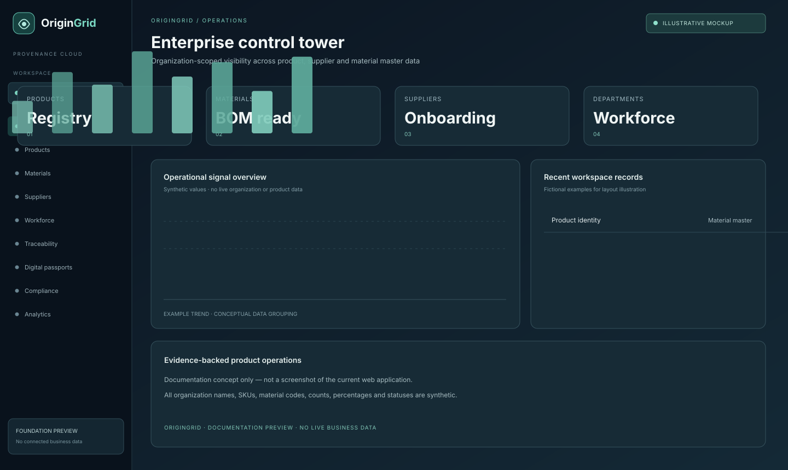
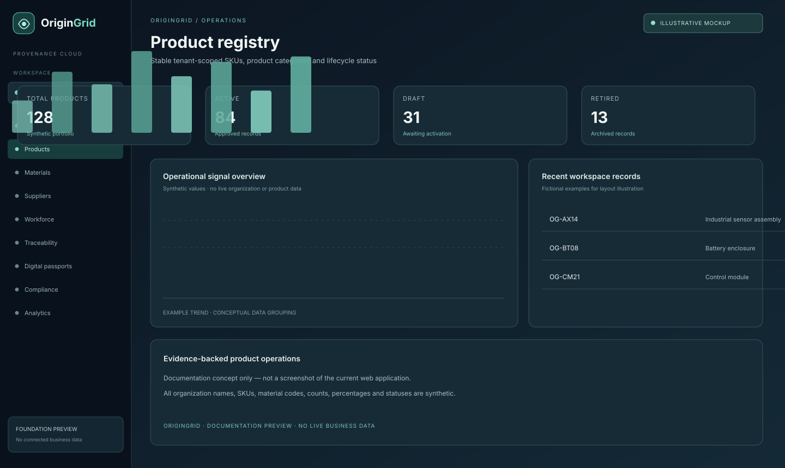
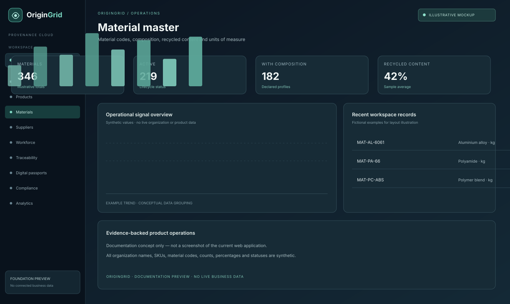
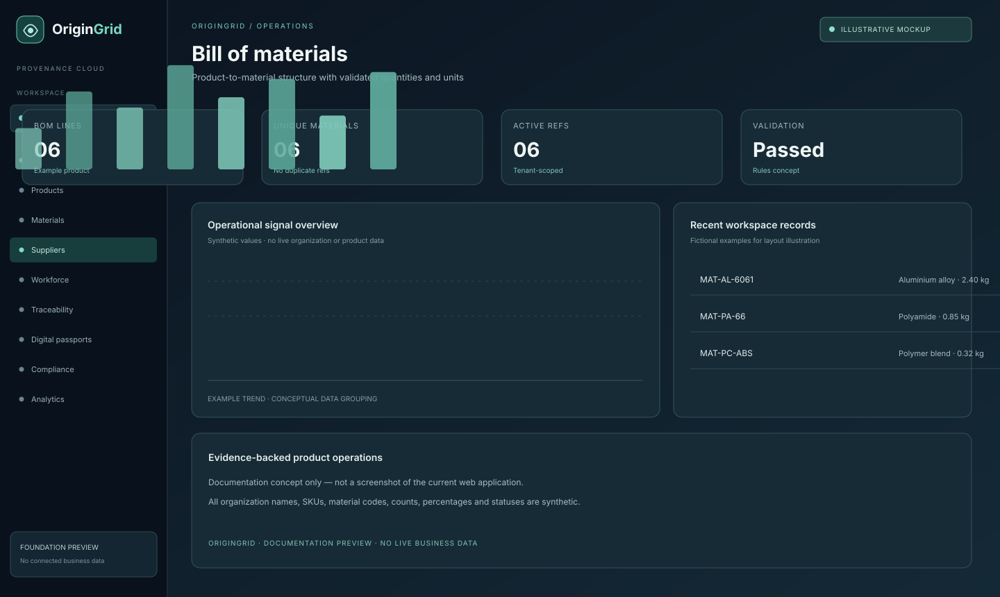
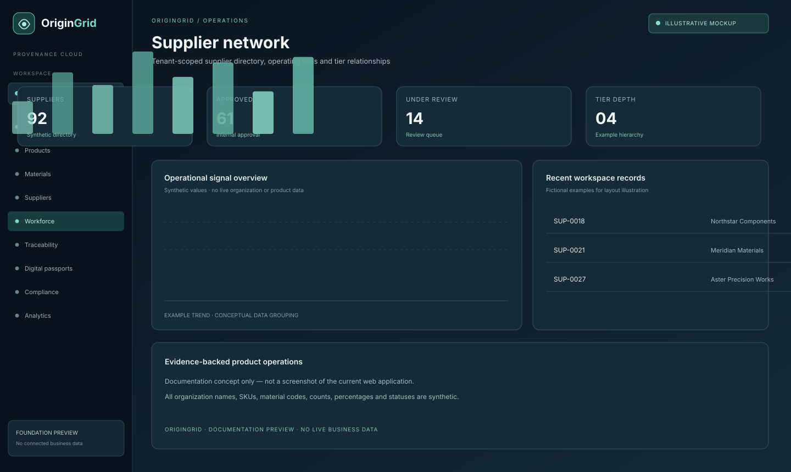
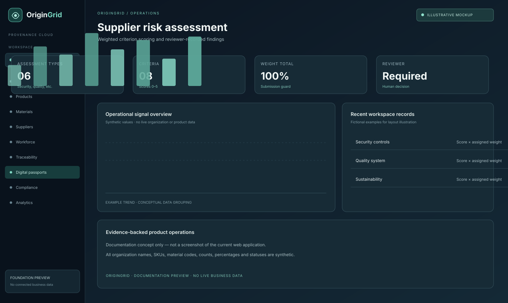
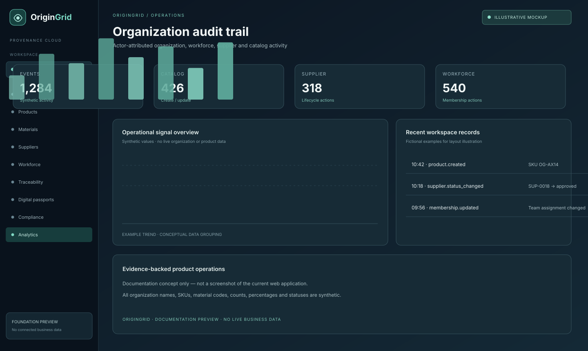
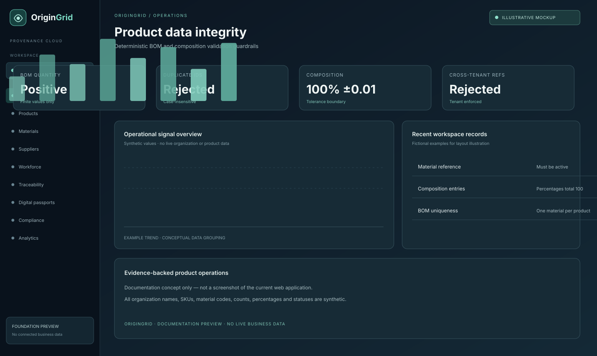

# OriginGrid

**Every Product Has a Story. Every Story Has Proof.**

OriginGrid is a multi-tenant enterprise product-provenance and Digital Product Passport platform foundation. It is designed to connect product and material master data with supplier organizations, workforce governance and—through future milestones—evidence-backed lifecycle traceability.

The current implementation establishes the enterprise foundation, identity and tenant boundaries, organization workforce, supplier ecosystem and product/material registry. It is a **modular-monolith foundation**, not yet a complete end-to-end traceability or Digital Product Passport product.

> **Current status:** Milestones 1–5 and the catalog-integrity follow-up are merged into `main`. The React application remains a foundation preview with placeholder metrics and workflows; it is not connected to the operational API. Provenance event capture, batch genealogy and public passport publication are future domains.

## At a glance

- **Problem space:** fragmented product, material and supplier master data across complex supply chains.
- **Current foundation:** tenant-aware identity, organization workforce, supplier registry and assessments, product/material catalog and bill of materials.
- **Primary users:** manufacturers, procurement and supplier-management teams, product-data owners, quality/compliance teams and organization administrators.
- **Architecture:** React web shell + Express API + MongoDB/Mongoose, organized as a modular monolith.
- **Data boundary:** organization scope is resolved by the authenticated server-side membership context.
- **Decision boundary:** supplier risk classifications are internal assessment outputs, not independent certifications or verified third-party facts.

## Implemented capabilities on `main`

### 1. Enterprise foundation and identity

- React 19, TypeScript and Vite web foundation.
- Node.js 22+, Express 5 and TypeScript API.
- MongoDB 7 with Mongoose 8.
- Zod-based environment and API request validation.
- Helmet, credentialed CORS allow-list, bounded request bodies and Pino HTTP logging with sensitive authorization/cookie headers redacted.
- Authentication endpoints for registration, login, refresh, logout and current-user profile.
- bcrypt password hashing and short-lived issuer/audience-constrained JWT access tokens.
- Opaque refresh tokens are stored as SHA-256 hashes; refresh rotation revokes prior tokens and reuse revokes the active token family.
- HttpOnly, SameSite=Strict refresh cookie; authentication endpoints are rate limited.

### 2. Organization tenancy and workforce

- Registration creates the initial organization and owner membership.
- Users can belong to multiple organizations through membership records.
- Tenant-facing APIs require a bearer access token and active `X-Organization-Id` membership context.
- Organization scope and role are derived from server-side membership; client-supplied roles are ignored.
- Organization roles: `owner`, `admin`, `member`, `viewer`.
- Membership can be assigned to one department and multiple teams within the same tenant.
- Email-bound invitations expire after seven days; only SHA-256 token hashes are stored.
- Invitation acceptance checks the authenticated user's normalized email.
- Organization, workforce and administration actions create actor-attributed audit events.

**Invitation delivery boundary:** invitation creation returns the one-time token to the authorized inviter; no transactional email provider is connected. Production deployment must integrate a verified delivery provider and must not expose invitation tokens in logs.

### 3. Supplier ecosystem

- Organization-scoped supplier directory with legal/display name, unique supplier code, country, categories, capabilities, contacts and operating sites.
- Supplier codes and normalized legal names are unique within an organization.
- Parent supplier references must belong to the same tenant; direct self-parenting and detected hierarchy cycles are rejected.
- Supplier lifecycle: `prospect → onboarding → under_review → approved`, with explicit rejected and suspended transitions.
- Supplier profile includes tier and internal risk classification (`low`, `medium`, `high`, `critical`, `unassessed`).
- Supplier assessments support security, quality, sustainability, compliance, financial and general assessment types.
- Criteria use 0–5 scores and weighted values; submission requires weights to total 100 and produces a normalized 0–100 score.
- Authorized reviewers record findings and a risk level.
- Supplier and assessment actions create organization audit events.

Supplier approval is an internal organization decision, not a third-party certification, legal attestation or proof that supplier claims are true. Assessment evidence currently stores metadata and a reference string only; it does not upload, scan or authenticate binary documents.

### 4. Product and material registry

- Tenant-scoped product master records with organization-unique SKU, category, product type, optional GTIN, model, brand and country-of-origin code.
- Product lifecycle values: `draft`, `active`, `retired`.
- Tenant-scoped material records with organization-unique material code, category, unit of measure, country of origin, optional supplier reference and lifecycle status.
- Material composition entries support substance names and percentage values; a non-empty composition must total 100% within 0.01 percentage points.
- Recycled-content percentage can be recorded as declared material metadata.
- Product bill of materials (BOM) references active materials from the same organization.
- BOM quantities must be finite and positive, units are required, and the same material cannot occur more than once in a BOM.
- Supplier and BOM material references are validated against the active organization.
- Unique indexes scope SKU, GTIN and material code by organization.
- Catalog list endpoints support search, status/category filters and bounded pagination (maximum 100 records per page).
- Product/material mutations create organization audit events.

These are master-data records and validation controls. They do not represent real-time inventory, procurement, verified recycled-content claims, carbon calculations or a complete product genealogy.

### 5. Catalog integrity and quality

Deterministic catalog validation is separated into testable domain rules. The API catalog unit suite currently covers normalization, duplicate BOM identifiers, invalid quantities, missing identifiers/units, composition totals, rounding tolerance, boundary values and optional empty collections.

The web workspace uses Vitest `passWithNoTests` until a browser/component test environment is introduced. A passing empty web test suite must not be interpreted as UI behavior coverage.

## Illustrative dashboard gallery

These 12 original SVG illustrations show possible information architecture for OriginGrid's current master-data foundation and future provenance domains. **They are documentation mockups, not screenshots of the deployed application.** All organization names, SKUs, material codes, counts, percentages, statuses and records are synthetic. The current web client is a foundation preview with placeholder values and is not connected to these illustrated dashboards.

### 1. Enterprise control tower

<p></p>

### 2. Product registry

<p></p>

### 3. Material master

<p></p>

### 4. Bill of materials

<p></p>

### 5. Supplier network

<p></p>

### 6. Supplier onboarding

<p></p>

### 7. Supplier risk assessment

<p></p>

### 8. Workforce and access

<p></p>

### 9. Organization audit

<p></p>

### 10. Product data integrity

<p></p>

### 11. API and platform health

<p></p>

### 12. Provenance and passport roadmap

<p></p>

## Architecture

OriginGrid currently uses a **modular monolith**: one Express API with explicit domain boundaries. This keeps the initial operational footprint small while allowing future domains to be extracted if justified.

```text
OriginGrid/
├── apps/
│   ├── api/
│   │   └── src/
│   │       ├── config/          # Environment and MongoDB connection
│   │       ├── controllers/     # HTTP request/response adapters
│   │       ├── middleware/      # Auth, tenant, role and error handling
│   │       ├── models/          # Identity, workforce, supplier and catalog schemas
│   │       ├── routes/          # Versioned API route modules
│   │       ├── services/        # Domain operations and validation
│   │       └── utils/           # Token helpers
│   └── web/src/                 # React foundation preview
├── docs/
│   ├── architecture/            # Domain and architecture decisions
│   ├── quality/                 # Catalog integrity rules
│   └── security/                # Security baseline and follow-up controls
├── docs/readme-dashboard/       # Illustrative SVG documentation assets
├── .github/workflows/ci.yml
├── docker-compose.yml
└── package.json                 # npm workspaces
```

**API request flow:** React/client → Express API under `/api/v1` → JWT authentication → tenant membership resolution from `X-Organization-Id` → role authorization → Zod validation → domain service → tenant-scoped MongoDB query.

**Planned, not connected:** Redis/BullMQ jobs, Socket.IO live updates and object storage appear in the architecture direction but are not wired into the current API. Provenance events, custody transfers, product genealogy and public passport projections are future domain modules.

## Technology stack

| Area | Technologies |
|---|---|
| Web | React 19, TypeScript, Vite 6, Tailwind CSS direction in project plan; current web styling is CSS |
| API | Node.js 22+, Express 5, TypeScript |
| Database | MongoDB 7, Mongoose 8 |
| Validation | Zod |
| Authentication | bcryptjs, JSON Web Tokens, opaque refresh tokens |
| Security / HTTP | Helmet, CORS, express-rate-limit, cookie-parser |
| Logging | Pino HTTP |
| Tests | Vitest |
| Workspace | npm workspaces |
| Local dependencies | Docker Compose (MongoDB 7, Redis 7) |
| CI | GitHub Actions: audit, typecheck, tests and build |

## Getting started

### Prerequisites

- Node.js 22 or later
- npm 10 or later
- Docker and Docker Compose
- Git

### 1. Clone the repository

```bash
git clone https://github.com/matiur25580/OriginGrid.git
cd OriginGrid
```

### 2. Configure the API

```bash
cp apps/api/.env.example apps/api/.env
```

Set `JWT_ACCESS_SECRET` to a unique random secret of at least 32 characters. Never commit real credentials.

### 3. Start local dependencies

```bash
docker compose up -d mongodb redis
```

MongoDB is used by the current API. Redis is included in Compose for future asynchronous workloads but is not currently connected to an application worker.

### 4. Install dependencies

```bash
npm install
```

### 5. Run API and web client

Open two terminals from the repository root.

Terminal 1 — API:

```bash
npm run dev
```

Terminal 2 — web foundation preview:

```bash
npm run dev:web
```

- Web preview: `http://localhost:5173`
- API: `http://localhost:4000`
- API prefix: `/api/v1`
- Liveness: `GET /api/v1/health`
- Readiness: `GET /api/v1/health/ready`

The web preview is currently a static foundation screen and does not yet call the supplier or catalog APIs.

## Environment configuration

The API's `apps/api/.env.example` defines:

| Variable | Purpose | Default |
|---|---|---|
| `NODE_ENV` | Runtime environment | `development` |
| `PORT` | API listen port | `4000` |
| `API_PREFIX` | Versioned API prefix | `/api/v1` |
| `MONGODB_URI` | MongoDB connection | `mongodb://localhost:27017/origingrid` |
| `CORS_ORIGIN` | Credentialed browser origin | `http://localhost:5173` |
| `JWT_ACCESS_SECRET` | JWT signing secret | Replace example value; minimum 32 characters |
| `LOG_LEVEL` | Pino log verbosity | `info` |

Do not expose server secrets through Vite/browser variables. Production deployments should use a managed secret store, explicit CORS origins, HTTPS and an operational key-rotation plan.

## API reference

All API routes use the configured prefix (default `/api/v1`). Tenant-protected endpoints require an Authorization bearer token and `X-Organization-Id` header for an active membership.

### Health and authentication

| Method | Endpoint | Purpose |
|---|---|---|
| GET | `/health` | API liveness |
| GET | `/health/ready` | MongoDB readiness |
| POST | `/auth/register` | Register user and initial organization |
| POST | `/auth/login` | Authenticate |
| POST | `/auth/refresh` | Rotate refresh credential |
| POST | `/auth/logout` | Revoke refresh session |
| GET | `/auth/me` | Current authenticated user |
| GET | `/organizations/context` | Resolve active organization and role |

### Organization and workforce

| Method | Endpoint | Purpose |
|---|---|---|
| PATCH | `/organizations/settings` | Update organization settings |
| GET/PATCH | `/organizations/members`, `/organizations/members/:membershipId` | List and update memberships |
| POST/GET | `/organizations/invitations` | Create and list invitations |
| DELETE | `/organizations/invitations/:invitationId` | Revoke invitation |
| POST | `/organizations/invitations/accept` | Accept invitation |
| GET/POST | `/organizations/departments` | List and create departments |
| PATCH/DELETE | `/organizations/departments/:departmentId` | Update and delete department |
| GET/POST | `/organizations/teams` | List and create teams |
| PATCH/DELETE | `/organizations/teams/:teamId` | Update and delete team |
| GET | `/organizations/audit-events` | Read organization audit events |

### Suppliers and assessments

| Method | Endpoint | Purpose |
|---|---|---|
| GET/POST | `/suppliers` | Search/list and register suppliers |
| GET/PATCH | `/suppliers/:supplierId` | Read and update supplier |
| PATCH | `/suppliers/:supplierId/status` | Apply supplier lifecycle transition |
| GET/POST | `/suppliers/:supplierId/assessments` | List and create assessments |
| POST | `/suppliers/:supplierId/assessments/:assessmentId/submit` | Submit weighted assessment |
| POST | `/suppliers/:supplierId/assessments/:assessmentId/review` | Record findings and reviewer risk level |

### Product and material catalog

| Method | Endpoint | Purpose |
|---|---|---|
| GET/POST | `/catalog/products` | List and create products |
| GET/PATCH | `/catalog/products/:productId` | Read and update product |
| GET/POST | `/catalog/materials` | List and create materials |
| GET/PATCH | `/catalog/materials/:materialId` | Read and update material |

Catalog and supplier list endpoints support pagination and filters documented in the domain guides. Catalog page size is bounded to 100 records.

## Security and data integrity

Implemented safeguards include:

- bcrypt password hashing, short-lived JWT access tokens and issuer/audience verification.
- Hashed opaque refresh tokens, refresh rotation and reuse-family revocation.
- HttpOnly, SameSite=Strict refresh cookie and authentication rate limiting.
- Helmet security headers, credentialed CORS configuration and bounded JSON/form request bodies.
- Authorization/cookie header redaction in HTTP logs.
- Server-derived tenant context; request-body organization IDs and client-supplied roles are not used as authorization.
- Tenant-scoped supplier, assessment, product, material and workforce queries.
- Role checks for owner/admin write operations.
- Zod validation at API boundaries and Mongoose schema/index constraints.
- Unique organization-scoped supplier codes, legal names, SKUs, GTINs and material codes.
- BOM active-material, tenant ownership, uniqueness and positive-quantity validation.
- Material composition percentage validation.
- Actor-attributed organization audit events.

**Audit limitation:** audit records are append-only by application convention and include immutable event timestamps, but privileged database operators remain in the threat model. This is not a cryptographically tamper-proof ledger.

**Evidence limitation:** supplier assessment evidence currently stores a title, reference string, type and optional expiry date. Binary upload, private object storage, malware scanning, immutable retention and document authenticity verification are not implemented.

## Testing and CI

Run from the repository root:

```bash
npm run typecheck
npm test
npm run build
npm run lint
```

The root scripts run the configured workspaces. The API's Vitest suite includes deterministic catalog rule tests. The web workspace currently uses `--passWithNoTests` until browser/component tests are added; UI behavior is therefore not covered by a web test suite yet.

The GitHub Actions workflow runs on configured pushes and pull requests and performs:

1. Node.js 22 setup and npm install
2. `npm audit --audit-level=moderate`
3. Workspace type-check
4. Unit tests
5. Workspace build

Workflow configuration is not proof that every commit passed. Check the exact GitHub Actions run for a commit's current result.

## Roadmap

The following are future engineering domains, not implemented features:

1. **Provenance ledger:** append-only product lifecycle events, manufacturing steps, custody transfers, evidence references and product genealogy.
2. **Digital Product Passport:** allowlisted public product projections, QR identifiers, access policy and revocation.
3. **Compliance and certification:** obligation mapping, certification records, controlled evidence workflows and expiry tracking.
4. **Sustainability intelligence:** methodology-versioned calculations, source traceability and product-level environmental reporting.
5. **Quality and recalls:** inspections, non-conformance, corrective actions, lot/batch impact analysis and recall investigations.
6. **Risk intelligence:** explainable signals, data lineage, human review and controlled analytics.
7. **Integrations:** verified supplier data exchange, transactional email, object storage, async jobs and external enterprise systems.
8. **Production hardening:** stronger tenant-isolation integration tests, audit retention/export, secret rotation, backups, monitoring, dependency/container scanning and independent security review.

## Engineering documentation

- [Architecture overview](docs/architecture/overview.md)
- [Identity, tenant and workforce architecture](docs/architecture/identity-and-tenancy.md)
- [Supplier ecosystem](docs/architecture/supplier-ecosystem.md)
- [Product and material registry](docs/architecture/product-material-registry.md)
- [Catalog integrity and validation](docs/quality/catalog-integrity.md)
- [Security baseline](docs/security/baseline.md)
- [CI workflow](.github/workflows/ci.yml)
- [API environment example](apps/api/.env.example)

## Contributing

Use focused branches and pull requests. Preserve milestone dependency order, include tests for behavior changes, and update domain documentation. Tenant isolation, role authorization, hierarchy integrity, lifecycle transitions, catalog constraints and audit behavior deserve both success and failure-path coverage.

Never commit production credentials, invitation tokens, private supplier contracts, personal data or confidential evidence.

## License

No open-source license is currently declared. A license is planned before public redistribution; until then, no open-source usage or redistribution rights are granted by this repository.
