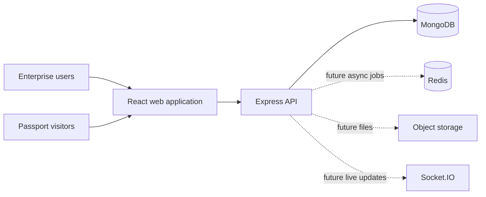

# Architecture Overview

## Architectural style
OriginGrid starts as a modular monolith: one deployable API with explicit domain boundaries. This reduces operational overhead while preserving the ability to extract high-load or independently governed domains later.

## Initial system context

## Planned domain boundaries
- Identity & Access: users, organizations, memberships, roles, permissions, sessions.
- Supplier Network: supplier profiles, relationships, onboarding, assessments.
- Product Registry: products, materials, components, bills of materials, batches.
- Provenance: lifecycle events, custody transfers, genealogy, verification.
- Digital Passport: publication policies, public projections, QR identifiers.
- Compliance: obligations, assessments, certifications, evidence.
- Sustainability: measurements, factors, calculations, reports.
- Quality: inspections, non-conformances, corrective actions, recalls.
- Intelligence: risk signals, analytics, AI-assisted workflows.

## Data ownership
Each domain owns its schemas and application services. Cross-domain access should happen through exported service interfaces, not direct imports of another domain's persistence implementation.

## Tenant isolation
Tenant-owned records will carry an organization identifier. The API derives the active organization from authenticated membership context; it must not trust a body/query organization ID as authorization. Repository methods must require tenant context. Cross-tenant access tests are required before tenant-facing modules ship.

## Provenance integrity
Provenance events are append-only at the application layer. Each event will include an actor, organization, subject, event type, occurred-at time, recorded-at time, evidence references, and a canonical payload hash. A hash-linked sequence can make unauthorized modification detectable, but does not make the database absolutely immutable or prove submitted facts are true.

## Public/private boundary
Digital Passport responses use explicit public DTOs and allowlisted fields. Internal supplier contracts, personal data, risk assessments, and confidential documents must never be serialized from internal database documents directly.